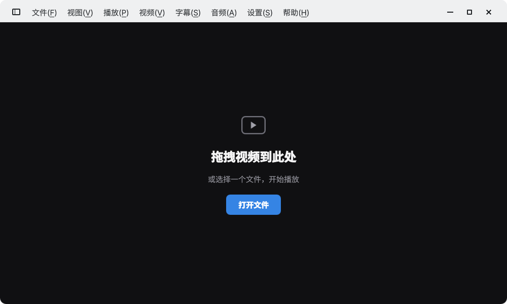

<!--
SPDX-FileCopyrightText: 2020 George Florea Bănuș <georgefb899@gmail.com>

SPDX-License-Identifier: CC-BY-4.0
-->

# ktmpv



ktmpv 是 [KDE Haruna](https://invent.kde.org/multimedia/haruna) 的分支，使用 C++、Qt Quick/QML 和 libmpv。它保留 Haruna 的播放和设置功能，重点调整了桌面界面与播放交互。

- 主窗口使用无边框圆角布局。顶部菜单、侧栏开关和窗口按钮共用圆角悬浮样式，窗口较窄时改用折叠菜单。
- 播放列表位于左侧。列表支持搜索、切换、添加文件与文件夹、排序和播放模式设置。
- 播放控件以单行悬浮在视频底部，鼠标移到该区域才显示。控件包括进度、音量、最大化和全屏。本地视频默认启用进度条帧预览。
- 空闲页面提供拖放和打开文件入口。设置页采用文字导航，统一了开关、数字输入和下拉框的样式，并修复了设置页加载警告和许可证对话框的布局循环。

## 在 Fedora 上安装

从 [Ktmpv Releases](https://github.com/kamiertop/ktmpv/releases) 下载与你的 Fedora 版本匹配的 **x86_64 RPM**。`fc44` 对应 Fedora 44，`fc45` 对应 Fedora 45。可用 `rpm -E %fedora` 查看自己的版本。

在 Fedora 45 上，可以用下面的命令安装下载的包。

```bash
sudo dnf install ./ktmpv-0.1.0-1.fc45.x86_64.rpm
```

DNF 会安装运行依赖。应用菜单中的名称仍是 **Haruna**，也可以用 `haruna` 启动。更新时下载新版本的 RPM 并用同一条安装命令，卸载用 `sudo dnf remove ktmpv`。

Ktmpv 沿用上游的 `haruna` 可执行文件名、`org.kde.haruna` 桌面 ID 和 Haruna 配置。它与 Fedora 仓库中的原生 `haruna` RPM 不能同时安装。如果已有原生 Haruna，先卸载该 RPM 再装 Ktmpv。原来的用户配置会继续使用。

## 从源码构建

当前源码要求 Qt ≥ 6.9 和 KDE Frameworks ≥ 6.24。RPM spec 记录了 Fedora 的编译依赖。

```bash
git clone https://github.com/kamiertop/ktmpv.git
cd ktmpv

sudo dnf install dnf5-plugins rpm-build
sudo dnf builddep packaging/ktmpv.spec
sudo dnf install kf6-qqc2-desktop-style qt6-qtwayland

cmake -S . -B build -G Ninja -DCMAKE_BUILD_TYPE=Release
cmake --build build --parallel 4
./build/bin/haruna
```

如果需要系统安装和卸载，请使用上面的 RPM 流程。

## 构建测试包与发布

[GitHub Actions 工作流](.github/workflows/release-rpm.yml) 在 Fedora 44 和 45 容器中构建 x86_64 RPM。每个包都会在对应容器中通过 DNF 安装并做离屏启动检查。完整的图形交互仍需在桌面环境中验证。

- 在 GitHub 的 **Actions → Fedora RPM → Run workflow** 选择分支即可构建测试包。成功后从该次运行的 **Artifacts** 下载，解压后用 DNF 安装。
- 正式发布前，确认 [RPM spec](packaging/ktmpv.spec) 的 `Version` 和 `%changelog` 对应本次发布。后续发布时递增 `Version`。提交并推送后，在该提交上创建与版本一致的标签。打包和启动检查通过后，工作流会发布 RPM 和 `SHA256SUMS` 到 Releases。

首个版本设为 `0.1.0`。在准备发布的提交上运行以下命令。

```bash
git push origin master
git tag -a ktmpv-v0.1.0 -m "Ktmpv 0.1.0"
git push origin ktmpv-v0.1.0
```

RPM 版本由 spec 管理，程序「关于」页仍显示 CMake 中的 Haruna 版本。`ktmpv-v` 前缀用来区分分支发布与上游标签。

## 同步 Haruna 上游

首次同步时，先添加上游远程仓库。

```bash
git remote add upstream https://invent.kde.org/multimedia/haruna.git
git fetch --no-tags upstream
git remote set-head upstream --auto
```

每次同步先在独立分支合并，确认构建和界面行为后再更新发布分支。开始前先提交正在进行的修改，保证工作区干净。

```bash
git switch master
git pull --ff-only origin master
git fetch --no-tags upstream
git switch -c sync-haruna
git merge upstream/HEAD

cmake -S . -B build -G Ninja -DCMAKE_BUILD_TYPE=Release
cmake --build build --parallel 4
./build/bin/haruna
```

如果合并产生冲突，逐个处理并完成合并提交，再继续构建。检查窗口、播放控件、播放列表、设置和缩略预览。若上游提高 Qt 或 KDE Frameworks 的最低要求，或改变安装文件，记得同步更新 spec 和工作流。

验证通过后，更新发布分支并清理已合并的临时分支。

```bash
git switch master
git merge --ff-only sync-haruna
git push origin master
git branch -d sync-haruna
```

需要发布时，按上节更新 RPM 版本并创建新标签。

## 上游与许可证

Haruna 由 George Florea Bănuș 和 KDE 社区开发。上游项目的介绍、截图与捐助入口见 [Haruna 官网](https://haruna.kde.org/)。文件的 SPDX 标记及 [LICENSES](LICENSES/) 记录各自适用的许可证。
